# H1 Capstone Project on the Reuse of Old Laptops as a Beowulf Cluster

# H2 Overview
The files listed in this repository are the shell scripts, YAML, and config files I created in the process of making a Beowulf Cluster using old laptops and SFF computers 
that would have otherwise been thrown out. The file directory is laid out below, showing where these files live on the cluster head node. A note that the home/clusteruser is a nfs
mount that is shared between all worker nodes in the cluster. 

# H2 Information
- All nodes in this cluster use Ubuntu Server LTS 26.04
    - For more detailed version and individual node information, go to hosts/gameserver and node/node*
- A list of all the required programs to run the cluster can be found in pxe/cluster-repo-packages.txt
- The raw results of each test run can be found in /results for both HPL and Sysbench 

# H2 Directory Structure Overview

```mermaid
graph TD
    classDef dir fill:#add8e6,stroke:#333,stroke-width:2px;
    classDef file fill:#e6e6fa,stroke:#333,stroke-width:1px;
    classDef special fill:#ffe4b5,stroke:#333,stroke-width:1px,stroke-dasharray: 5 5;

    ROOT([root/ 📁]):::dir
    ETC([etc/ 📁]):::dir
    HOME([home/ 📁]):::dir
    SRV([srv/ 📁]):::dir

    ROOT --> ETC
    ROOT --> HOME
    ROOT --> SRV

    subgraph etc
        ETC --> CHRONY([chrony/ 📁]):::dir
        CHRONY --> CHRONY_CONF([chrony.conf 📄]):::file
        CHRONY --> CLUSTER_CONF([conf.d/cluster.conf 📄]):::file
        
        ETC --> DNSMASQ_D([dnsmasq.d 📄]):::file
        ETC --> EXPORTS([exports 📄]):::file
        ETC --> FSTAB([fstab 📄]):::file
        ETC --> HOSTS([hosts 📄]):::file
        ETC --> NETPLAN([netplan/ 📁]):::dir
        ETC --> NFS_CONF([nfs.conf 📄]):::file
        ETC --> NGINX([nginx/ 📁]):::dir
        NGINX --> NGINX_CONF_D([conf.d 📄]):::file
    end

    subgraph home
        HOME --> CLUSTERUSER([clusteruser/ 📁]):::dir
        CLUSTERUSER --> HOSTFILE([hostfile 📄]):::file
        CLUSTERUSER --> BASHRC([clusteruser.bashrc 📄]):::file
        CLUSTERUSER --> HPL([hpl-runs 📄]):::file
    end

    subgraph srv
        SRV --> NFS_SRV([nfs/ 📁]):::dir
        NFS_SRV --> NFS_ISO([ubuntu.iso 💿]):::file
        
        SRV --> TFTP([tftp/ 📁]):::dir
        TFTP --> TFTP_GRUB([grub/grub.cfg 📄]):::file
        TFTP --> TFTP_PXE([pxelinux.cfg/default 📄]):::file
        TFTP --> TFTP_KERNEL[".efi,.c32,.0,linux iso kernel"]:::special
        
        SRV --> WWW([www/ 📁]):::dir
        WWW --> AUTOINSTALL([autoinstall/ 📁]):::dir
        AUTOINSTALL --> META([meta-data, user-data, vendor-data 📄]):::file
        
        WWW --> CLUSTERREPO([cluster-repo/ 📁]):::dir
        CLUSTERREPO --> CLUSTERREPO_NOTE(["local copies of all necessary software go here<br/>with a package list and package.gz file"]):::special
        
        WWW --> DEFAULT_CONF([default.conf 📄]):::file
    end
```

